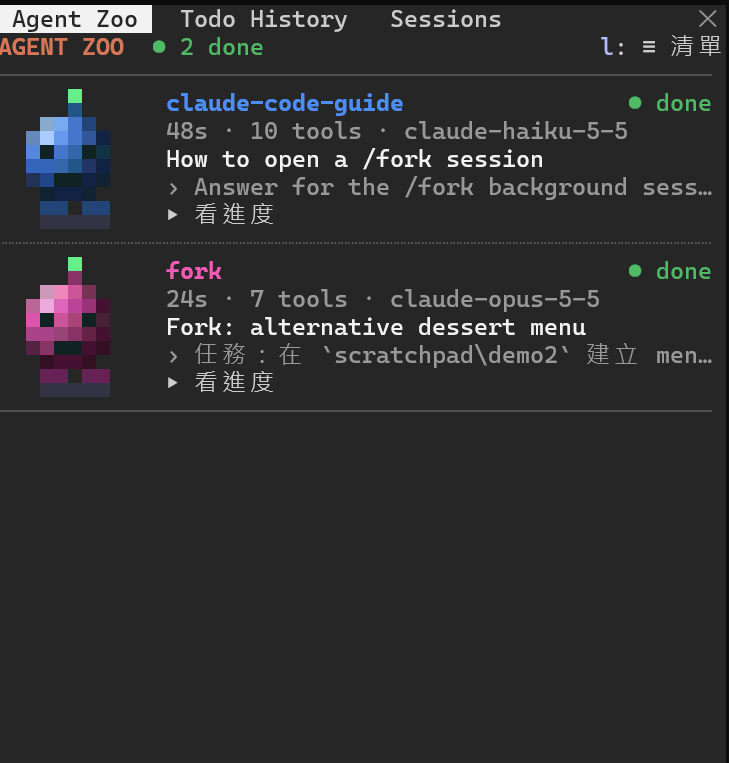
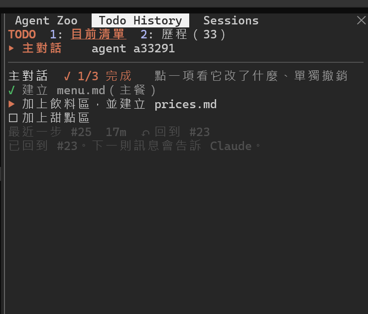
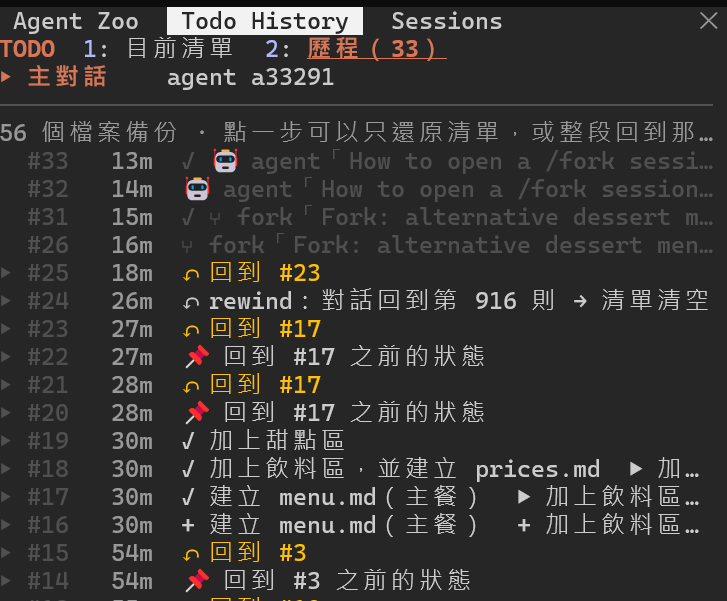
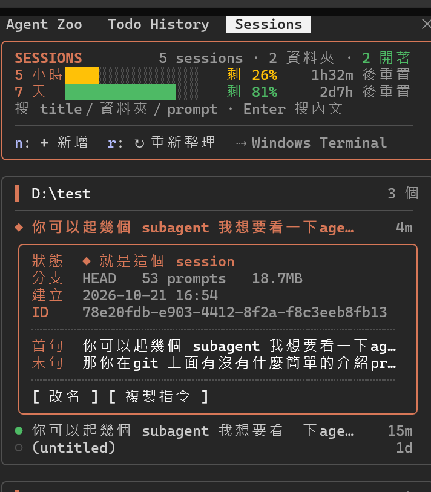

# claude-mods

[English](README.md) | **繁體中文**

Claude Code 的三個 mod（hooks-module plugin），都會在對話旁邊開一個常駐 panel。macOS 和 Windows 都能用。

| Mod | 一句話 | 指令 |
| --- | --- | --- |
| **agent-zoo** | 每個 sub-agent／fork 都是一隻 3D 像素小機器人，點開看它即時在做什麼 | `/agent-zoo` |
| **todo-history** | todo 清單的完整歷程：單獨撤銷一個 task、整段回到某一步，rewind 時清單自動跟著回去 | `/todos` |
| **session-manager** | 這台電腦所有 Claude Code session 的列表：搜尋、resume、打開背景 session，順便顯示剩餘額度 | `/session-manager` |

```
/plugin install agent-zoo --marketplace chacharoot/claude-mods
/plugin install todo-history --marketplace chacharoot/claude-mods
/plugin install session-manager --marketplace chacharoot/claude-mods
```

## 預覽

**agent-zoo**：跑著的 agent 會跳、做完會笑；點「▸ 看進度」看它說了什麼、用了哪些工具。



**todo-history**：「目前清單」看進度、點一項單獨撤銷；「歷程」看每一步、回到任一步，agent 和 fork 也在裡面。

 

**session-manager**：依資料夾分組，上方是 5 小時／7 天的剩餘額度。



## session-manager

列出這台機器上所有的 Claude Code session，依資料夾分組，可以用滑鼠點選。

- 搜尋：打字即時篩選 title／資料夾／prompt，按 Enter 搜所有對話內文
- 預覽：搜尋後每個 session 列出每一處命中（誰說的、什麼時候）；點一處看它前後的對話，命中的字會標亮，`j`／`k` 換下一處、上一處，`m` 多看幾則。沒搜尋時按「預覽對話」（`p`）看最後幾則，用來分辨長得像的 session
- 點一個 session 展開詳細資料：
  - 已開著的 → **跳過去**（Terminal、iTerm 會直接切到那個分頁；Warp 只能叫出 app）
  - 背景 session（`/fork` 或 `--bg` 開的，沒有自己的視窗）→ **打開**，在新分頁執行 `claude attach` 進到那個對話；在空白輸入框按 ← 離開，它會繼續在背景
  - 已關閉的 → **Resume**，在新視窗開（Warp／iTerm／Terminal，按 `a` 切換）
  - **改名**（寫入跟 `/rename` 一樣的記錄）、**複製指令**、**刪除**（移到垃圾桶，可救回）
- **+ 新增**：選資料夾開新 session
- 標題區下方顯示剩餘額度（5 小時、7 天）和多久後重置
- 指令：`/session-manager`；`/sessions` 沒被其他 mod（例如 session-monitor）佔用時也能用

需求：Python 3（用來讀超過 4MB 的 transcript；依序試 `python3`、`python`、`py -3`）。Windows 沒有 Python 時改用內建的 PowerShell 跑同樣的功能，不用另外安裝。

| | macOS | Windows |
| --- | --- | --- |
| 列表、搜尋、改名 | ✓ | ✓ |
| Resume／新增 | Warp、iTerm、Terminal | Windows Terminal 新分頁（沒有 `wt` 時開 cmd 視窗） |
| 跳到已開著的 session | Terminal、iTerm 直接切分頁；Warp 只叫出 app | 只提示它在哪（Windows Terminal 不讓外部選分頁） |
| 打開背景 session | 新視窗 `claude attach` | Windows Terminal 新分頁 `claude attach` |
| 刪除 | 移到垃圾桶 | 移到資源回收筒 |
| 複製指令 | shell 語法 | PowerShell 語法 |

## agent-zoo

每個 sub-agent 都是一顆有光影的 3D 小機器人（終端機半格像素，Windows Terminal、Warp、iTerm 都能顯示），顏色代表類型：執行中會跳、眼睛左右看，等待時閉眼，完成時笑，失敗時打叉。旁邊顯示類型、跑了多久、用了幾次工具、現在在做什麼；超過 60 秒沒動靜會標 idle。

**點「▸ 看進度」**（清單模式點一整列）展開那個 agent 的即時進度：它收到的任務、說了什麼、呼叫了哪些工具和結果，跑的時候會自己更新；**主畫面看完整對話**直接把主畫面切到它的完整 transcript。按 `l` 切換成**清單模式**：一個 agent 一行、依「誰叫起誰」縮排成樹，agent teams 的 teammate 依團隊分組，agent 多的時候也放得下。Teammate 一輪做完會顯示 waiting（等下一則訊息），不會被當成 done。

小機器人預設是 10×5 格；想要原本 18×9 的大隻，用 `/agent-zoo big`（`/agent-zoo small` 換回來，會記住）。

**團隊對話**：用 agent teams 時，lead 和 teammate 之間用 SendMessage 傳的訊息會像通訊軟體一樣顯示在 zoo 下方的「TEAM CHAT」：lead 在右、teammate 在左，每個人有自己的顏色和一隻依名字挑的動物頭像（lead 是 👑），氣泡上標「誰 → 誰」和時間；點名字看全文，`c` 隱藏／顯示，「清空」清掉紀錄。只記得到在這個 Claude Code 程序裡跑的 agent（tmux 分割窗格的 teammate 是另一個程序，看不到）。

指令：`/agent-zoo` 打開 panel，`/agent-zoo compact` 切換清單模式，`/agent-zoo chat` 隱藏／顯示團隊對話，`/agent-zoo big`／`small` 切換機器人大小，`/agent-zoo clear` 清掉已完成的。

## todo-history

Claude 的 todo（`TodoWrite`）和 task（`TaskCreate`／`TaskUpdate`）每變一次就記一步（Claude Code 沒提供這些工具時，todo-history 會自己提供一個 `todo` 工具給 Claude 用），主對話、各個 sub-agent、共用 task 清單分開記。panel 上方是現在的清單，下面是歷程：`▶ 開始`、`✓ 完成`、`+ 新增`、`− 移除`。

三種返回，各管各的：

| 想要 | 怎麼做 | 動到什麼 |
| --- | --- | --- |
| **只撤銷某一個 task**，其他 task 的成果保留 | 在「現在」的清單點那一項 → **撤銷這個 task** | 只有它進行時改的檔案回到它開始前；後來別的 task 也改過的檔案不硬蓋，會把這個 task 的 diff 交給 Claude，請它只拿掉那部分。task 變回 ☐ |
| **某一步之後全部不要**，但保留對話 | 在歷程點那一步 → **整段回到這一步** | 清單回到那一步，之後用 Edit／Write 改過的檔案全部還原（之後才新增的會刪掉） |
| **某一步之後全部不要**，連對話一起 | Claude Code 的 rewind（按兩下 Esc） | 對話和程式碼由 rewind 處理；todo-history 會在幾秒內偵測到，把清單自動跟著回到那時候（記一筆 `↶ rewind`） |

前兩種都會先記一步「📌 …之前的狀態」並備份要動的檔案，按錯了就回到那一步反悔；完成後你下一則訊息會自動告訴 Claude 發生了什麼。歷程裡也會列出 sub-agent 和 fork 的開始與結果（🤖／⑂）。

用 Bash／PowerShell 改的檔案不會被記錄。rewind 是靠比對對話判斷的（變短、而且前面的訊息一模一樣才算；`/compact` 不會被誤認）。歷程和檔案備份存在 `~/.claude/todo-history/<session id>/`。

panel 分成兩頁：**目前清單**（`1`）和**歷程**（`2`）。還有工作沒做完時，輸入框上方會常駐一行顯示進行中的 task（`▶ … ✓ 1/3`）。紀錄跟著 session 走：新 session 從空的開始，用 `claude -c`／`--resume` 接續時清單和歷程會回來。

指令：`/todos` 打開 panel，`/todos clear` 清掉這個 session 的歷程。

## 安裝

這是 private repo：你要先被邀請進這個 repo，而且電腦上的 git 要能讀 github.com（SSH key，或 `gh auth login` 後再 `gh auth setup-git`），安裝時不會詢問帳密。

在 Claude Code 的輸入框：

```
/plugin install session-manager --marketplace chacharoot/claude-mods
/plugin install agent-zoo --marketplace chacharoot/claude-mods
/plugin install todo-history --marketplace chacharoot/claude-mods
```

第一次會問 `Add marketplace?`，按 `y`；再選 scope，直接 Enter 選 user。裝好就會在這個 session 生效，之後每個新 session 都會載入。

從 shell 安裝：

```
claude plugin install session-manager --marketplace chacharoot/claude-mods
claude plugin install agent-zoo --marketplace chacharoot/claude-mods
claude plugin install todo-history --marketplace chacharoot/claude-mods
```

Desktop app 裡 `/plugin` 不能用：點輸入框旁的 **+** → **Plugins** → **Add marketplace** 填 `chacharoot/claude-mods` → **Add plugin**。

## 更新

```
claude plugin update session-manager@claude-mods
claude plugin update agent-zoo@claude-mods
claude plugin update todo-history@claude-mods
```

再在 Claude Code 裡打 `/reload-plugins`。改了什麼見 [CHANGELOG.md](CHANGELOG.md)。
